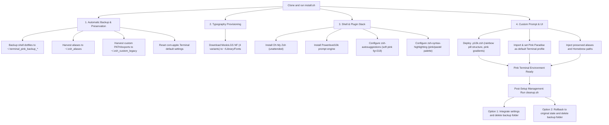

# Pink As Hell - macOS Terminal Customization Suite

A turn-key terminal customization suite engineered to transform a stock macOS Terminal into a high-contrast, pink aesthetic development environment powered by Powerlevel10k, Oh My Zsh, and MesloLGS NF.

---

## Architecture and Workflow



---

## Features

- **Non-Destructive Automation**: Automatically captures a full snapshot of all existing shell files before making any modifications.
- **Zero Loss of Configuration**: Extracts pre-existing aliases into `~/.zsh_aliases` and preserves custom exports in `~/.zsh_custom_legacy`.
- **Automated Font Provisioning**: Downloads and registers all four styles of MesloLGS NF (`Regular`, `Bold`, `Italic`, `Bold Italic`) directly into `~/Library/Fonts`.
- **Architectural Portability**: Automatically handles Homebrew prefix differences between Apple Silicon (`/opt/homebrew`) and Intel (`/usr/local`).
- **Curated Visual Profiles**:
    - **Pink Paradise**: Dark velvet midnight plum background with glowing neon pink accents.
    - **Pastel Sakura**: Light strawberry milk background with deep berry rose typography.
    - **iTerm2 Preset**: Includes `PinkParadise.itermcolors` for cross-emulator workflows.

---

## Quick Start

### 1. Installation
Clone the repository and execute the installer:

```bash
git clone https://github.com/<username>/pink-mac-terminal.git
cd pink-mac-terminal
chmod +x install.sh cleanup.sh
./install.sh
```

Restart Terminal or apply changes immediately:
```bash
exec zsh
```

### 2. Post-Setup Management
Once you have tested the new terminal environment, run the management utility:

```bash
# Interactive menu:
./cleanup.sh

# Non-interactive CLI flags:
./cleanup.sh --integrate    # Merge aliases into ~/.zsh_aliases and remove backup directory
./cleanup.sh --restore      # Full rollback: restore original shell files and default profile
./cleanup.sh --delete-only  # Remove backup directories while keeping the pink theme
```

---

## Automatic Backup and Preservation

All modifications are preceded by an automated backup routine:

| Setting / Asset | Backup Target | Preservation Mode |
| :--- | :--- | :--- |
| Original shell files (`.zshrc`, `.zprofile`, `.zshenv`) | `~/.terminal_pink_backup_YYYYMMDD_HHMMSS/` | Automatic snapshot |
| User aliases (including embedded `.zshrc` definitions) | `~/.zsh_aliases` | Extracted and linked |
| Custom environment variables & PATH declarations | `~/.zsh_custom_legacy` | Extracted and sourced |
| Terminal preferences | Property list snapshot | Cached in backup folder |

---

## Theme Comparison

| Profile | Mode | Background | Accent / Bold | Primary Use Case |
| :--- | :--- | :--- | :--- | :--- |
| **Pink Paradise** | Dark Velvet | `#1a0f1b` (Midnight Plum) | `#ff52bf` (Neon Hot Pink) | Low-light coding, high-contrast pink aesthetic |
| **Pastel Sakura** | Light Milk | `#fff0f5` (Strawberry Milk) | `#be185d` (Deep Berry Rose) | High-illumination environments, soft pastel tones |

---

## Deployment & Configuration Mappings

| Component / Subsystem | Target Location | Operational Role |
| :--- | :--- | :--- |
| **Automation Suite** | `install.sh`, `cleanup.sh` | Turn-key deployment, backup preservation, and single-command rollback manager |
| **Prompt Engine** | `~/.p10k.zsh` | Segmented pill Powerlevel10k prompt with blurred heads and transient prompt mode |
| **Terminal Profiles** | Terminal.app Preferences | Dark mode plum (`PinkParadise.terminal`) and light mode strawberry milk (`PastelSakura.terminal`) |
| **iTerm2 Preset** | iTerm2 Color Presets | Equivalent cross-emulator color scheme preset (`PinkParadise.itermcolors`) |

---

## Compatibility and Prerequisites

- **Operating System**: macOS 12 (Monterey) or later (Apple Silicon `arm64` and Intel `x86_64`).
- **Default Shell**: `zsh` (macOS default).
- **Network Access**: Required during initial setup to download fonts and clone Oh My Zsh plugins from GitHub.
